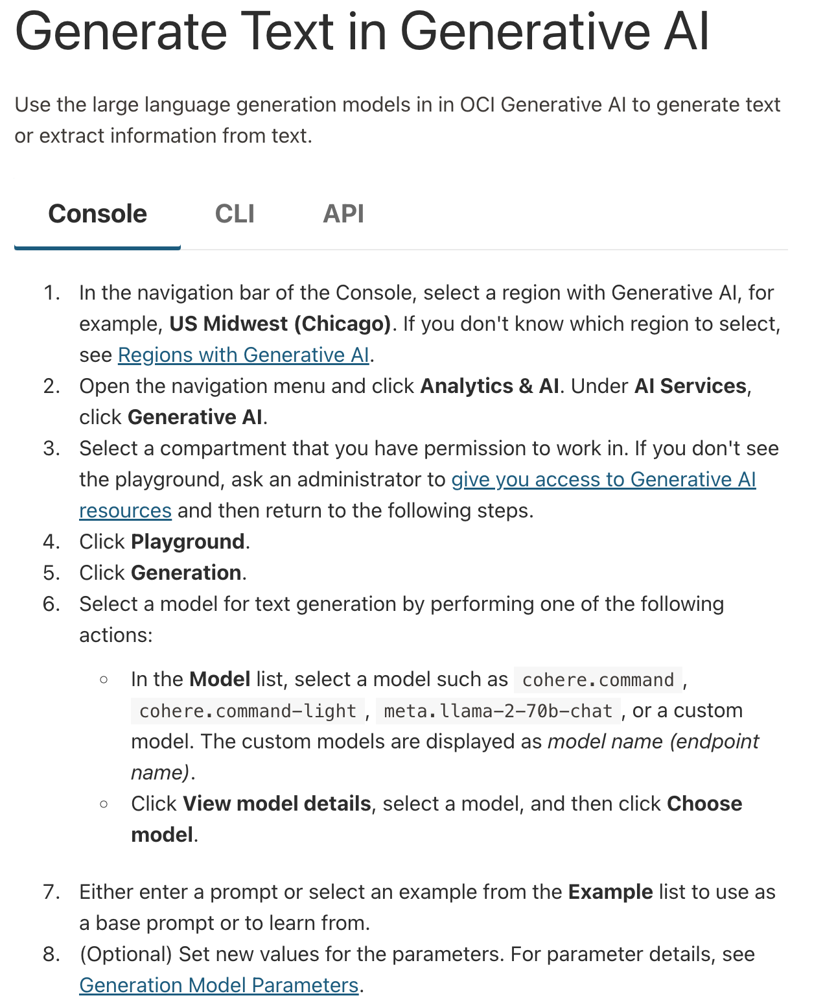
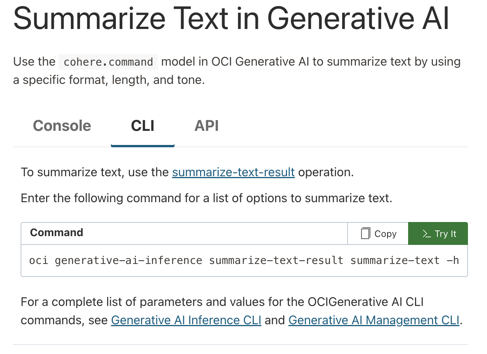
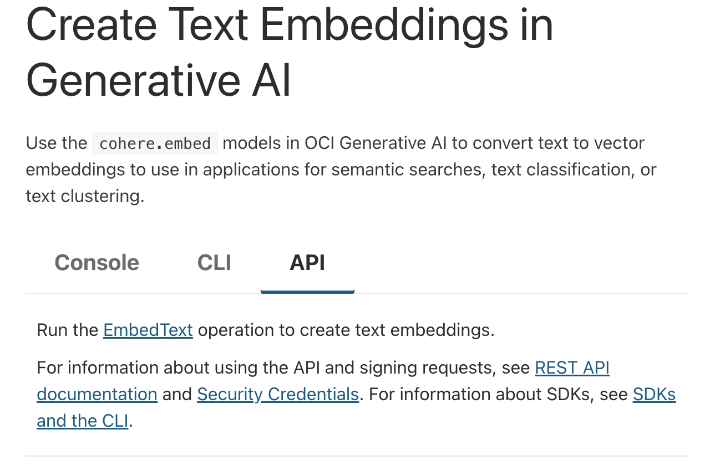

In an effort to make our language-model capabilities more widely available, we've partnered with a few major platforms to create hosted versions of our offerings.

Here, you'll learn how to use Oracle Cloud Infrastructure (OCI) to deploy the Cohere Command, Embed, and Rerank models on the Oracle cloud computing platform. The following models are available on [OCI Generative AI](https://docs.oracle.com/en-us/iaas/Content/generative-ai/pretrained-models.htm):

- [Command A Reasoning](https://docs.oracle.com/en-us/iaas/Content/generative-ai/cohere-command-a-reasoning-08-2025.htm) (`cohere.command-a-reasoning`, dedicated AI clusters only)
- [Command A Vision](https://docs.oracle.com/en-us/iaas/Content/generative-ai/cohere-command-a-vision-07-2025.htm) (`cohere.command-a-vision`)
- [Command A](https://docs.oracle.com/en-us/iaas/Content/generative-ai/cohere-command-a-03-2025.htm) (`cohere.command-a-03-2025`)
- [Embed 4](https://docs.oracle.com/en-us/iaas/Content/generative-ai/cohere-embed-4.htm) (`cohere.embed-v4.0`)
- Embed English v3 (deprecated)
- Embed English v3 light (deprecated)
- Embed Multilingual v3 (deprecated)
- Embed Multilingual v3 light (deprecated)
- [Rerank 4 Pro](https://docs.oracle.com/en-us/iaas/Content/generative-ai/cohere-rerank-4-0.htm) (`cohere.rerank-v4.0-pro`, dedicated AI clusters only)
- [Rerank 4 Fast](https://docs.oracle.com/en-us/iaas/Content/generative-ai/cohere-rerank-4-0.htm) (`cohere.rerank-v4.0-fast`)
- Rerank 3.5 (deprecated)

Oracle lists the Embed v3 models as deprecated with a retirement date of October 21, 2026, and Rerank 3.5 as deprecated with a dedicated-mode retirement date of January 8, 2027; the recommended replacements are Embed 4 and Rerank 4. See Oracle's model retirement dates for [on-demand](https://docs.oracle.com/en-us/iaas/Content/generative-ai/deprecating-on-demand.htm) and [dedicated](https://docs.oracle.com/en-us/iaas/Content/generative-ai/deprecating-dedicated.htm) mode. The Command R and Command R+ (08-2024) models were retired from OCI Generative AI on July 30, 2026, and the earlier Command R, Command R+, Command, and Command light models were retired before that. Fine-tuning is not available for the current Cohere models on OCI.

## Working With Cohere Models on OCI

There are three main tasks you can do with Cohere models on OCI:

- [Text generation](https://docs.oracle.com/en-us/iaas/Content/generative-ai/use-playground-generate.htm#playground-generate)
- [Summarization](https://docs.oracle.com/en-us/iaas/Content/generative-ai/use-playground-summarize.htm#playground-summarize)
- [Embeddings generation](https://docs.oracle.com/en-us/iaas/Content/generative-ai/use-playground-embed.htm#playground-embed)

And OCI offers three ways to perform these workloads:

- The console
- The CLI
- The API

In the sections that follow, we'll briefly outline how to use each, and link out to other documentation to fill in any remaining gaps. 

### The Console

OCI offers a console through which you can perform many generative AI tasks. It allows you to select your region and the model you wish to use, then pass a prompt to the underlying model, configuring parameters as you wish.

If you want to use the console for [text generation](https://docs.oracle.com/en-us/iaas/Content/generative-ai/use-playground-generate.htm#playground-generate), [summarization](https://docs.oracle.com/en-us/iaas/Content/generative-ai/use-playground-summarize.htm#playground-summarize), and [embeddings](https://docs.oracle.com/en-us/iaas/Content/generative-ai/use-playground-embed.htm#playground-embed), visit those links and select "console."

### The CLI

With OCI's command line interface (CLI), it's possible to use Cohere models to generate text, get embeddings, or extract information. 

If you want to use the console for [text generation](https://docs.oracle.com/en-us/iaas/Content/generative-ai/use-playground-generate.htm#playground-generate), [summarization](https://docs.oracle.com/en-us/iaas/Content/generative-ai/use-playground-summarize.htm#playground-summarize), and [embeddings](https://docs.oracle.com/en-us/iaas/Content/generative-ai/use-playground-embed.htm#playground-embed), visit those links and select "CLI."

### The API

If you're trying to use Cohere models on OCI programmatically -- i.e. as part of software development, or while building an application -- you'll likely want to use the API.

If you want to use the console for [text generation](https://docs.oracle.com/en-us/iaas/Content/generative-ai/use-playground-generate.htm#playground-generate), [summarization](https://docs.oracle.com/en-us/iaas/Content/generative-ai/use-playground-summarize.htm#playground-summarize), and [embeddings](https://docs.oracle.com/en-us/iaas/Content/generative-ai/use-playground-embed.htm#playground-embed), visit those links and select "API."

