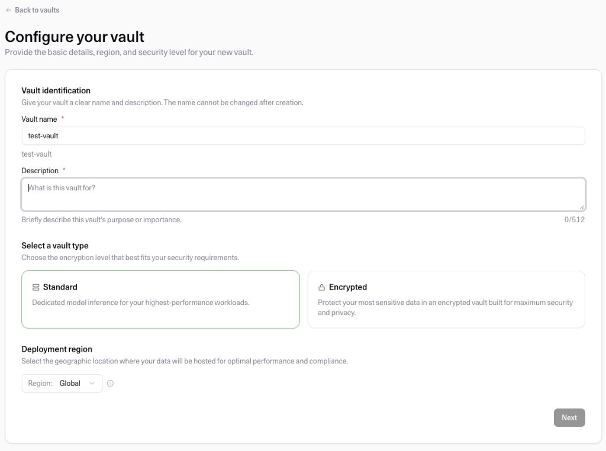
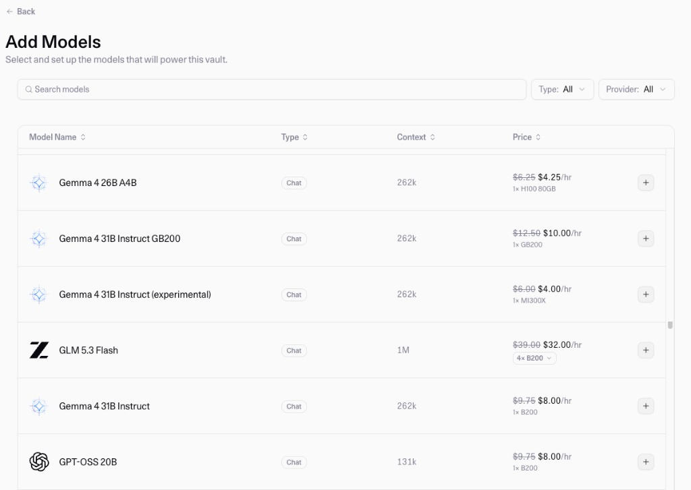

To create a new Vault, click `New Vault +` in the top-right corner of the
[home page](../../docs/model-vault/vault-home).

## Configure your vault

On this step:

- Enter a name and a description for your Vault. The name can't be changed after creation.
- Select the vault type, **Standard** or **Encrypted**. This can't be changed after creation.
- Choose the [deployment region](../../docs/model-vault/regions) the Vault runs in (Global, EU, or CAN). This can't be changed after creation.

Click `Next`.

## Add models

The catalogue lists Cohere's models and third-party
[open models](../../docs/model-vault/standard/supported-models#open-models) available for the vault
type and region you selected. Here, you can:

- Search the catalogue, or filter it by type and provider.
- Check each model's type, context length, and hourly price for one replica on the GPU shown.
- Choose a different GPU from the menu under the price, when a model runs on more than one.
- Click `+` to add a model, and set its minimum and maximum number of replicas. You can add more than
  one model to a Vault.

For North, see [Model Vault with North](../../docs/model-vault/model-vault-with-north).

When you're done, click `Deploy`.

<Warning>
There is currently a limit of **three** Vaults per organization. Reach out to your Cohere
representative to request an increase.
</Warning>

For the models available to each vault type, see
[Standard Vault → Supported Models](../../docs/model-vault/standard/supported-models) and
[Encrypted Vault → Supported Models](../../docs/model-vault/encrypted/supported-models).

## Next steps

- [Managing Vaults](../../docs/model-vault/managing-vaults)
- [Calling a Vault over the API](../../docs/model-vault/standard/api-access)
