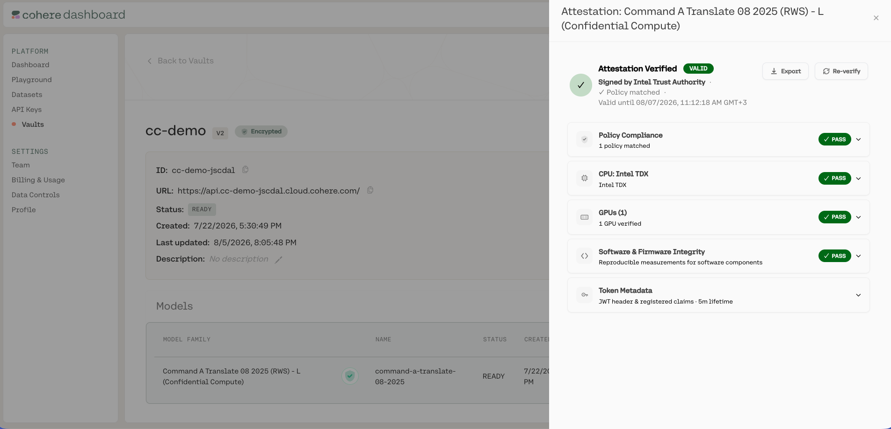

This page covers how you verify a Model Vault Encrypted deployment in practice. For the underlying
mechanism, see [Remote Attestation](../../../docs/model-vault/encrypted/attestation).

The verification that actually protects your data is **automatic and client-side**: the Cohere OHTTP
proxy checks attestation on every connection, binds it to the key it encrypts to, and refuses to
connect if anything is wrong. Separately, the Model Vault app displays a vault's attestation details
for at-a-glance status and audit. That display is informational; it is the client-side check, not the
app view, that gates your traffic.

## Automatic verification (the Cohere OHTTP proxy)

You do not have to do anything manually for verification to occur. The client-side **Cohere OHTTP
proxy**, whether run as a standalone proxy or used as a Python package, runs the full check on every
session and **refuses the connection** if anything is wrong:

1. It fetches the deployment's OHTTP public key together with its attestation evidence (on AMD SEV-SNP, using the background check model) or its attestation token (on Intel TDX, using the passport model).
2. It confirms the result is **authentic**. On AMD SEV-SNP, it appraises the raw evidence directly, checking the SEV-SNP report against AMD's certificate chain and the GPU evidence through NVIDIA's Remote Attestation Service (NRAS). On Intel TDX, it verifies the token's signature against Intel Trust Authority's published public keys (JWKS), confirming Intel genuinely issued it and it was not tampered with.
3. It confirms the attestation **policy matched**, meaning the hardware was genuine and the measured software matched the approved values.
4. It confirms the OHTTP public key is cryptographically **bound to the attested TEE**, so it is encrypting only to the genuine environment.
5. It confirms the result is **fresh**: the evidence answers the proxy's own nonce (background check), or the token is still within its short validity window (passport).

Only if all of these pass does the proxy encrypt and send your request.

In the background check model, freshness comes from the proxy's own challenge: each time the proxy
fetches the OHTTP key, it sends a new nonce, and the evidence must contain it, so a recording of an
earlier attestation cannot pass.

In the passport model the proxy does not run its own nonce challenge against the deployment. Freshness
is instead guaranteed by the token's short lifetime: Intel Trust Authority issues a token only after a
nonce exchange with the VM that produced the evidence, so a valid, unexpired token attests that the
underlying evidence was fresh when ITA appraised it. Tokens are valid for only a few minutes and are
refreshed periodically, so the result reflects the environment's current state.

## Inspecting attestation in the Model Vault app

Each confidential-computing model carries a green shield in the Model Vault app. Click it to open the
attestation details, where the result is broken down into hardware, firmware, software, and policy
checks:

The single most important field is the **policy result**: if the attested evidence matched an approved
policy, the overall verdict is secure. The sections below explain what each group of fields tells you;
where the AMD SEV-SNP and Intel TDX paths differ, both are listed.

<Note title="The app view is informational, not the security boundary">
What you see in the Model Vault app is a convenient status display, not proof of the environment that
served a particular request: nothing about the rendered details binds them to your actual connection,
so they should not be relied on as a standalone guarantee. The tamper-resistant guarantee comes from
the client-side Cohere OHTTP proxy check, which binds the attestation to the OHTTP key it encrypts to
on every connection, and from the per-response attestation certificate your application can verify.
Use the app view for review and the client-side verification for trust decisions.
</Note>

### Overall token

On Intel TDX, the **Token Metadata** section describes the token issued by Intel Trust Authority.
On AMD SEV-SNP, the app shows only the token's validity window at the top of the panel; use
**Export** to download the full signed token.

| Field | What it tells you | Expected |
| --- | --- | --- |
| Issuer | Who issued the token | Intel Trust Authority |
| Signature algorithm | How the token is signed | PS384 |
| Issued / expires | When attestation was performed and its validity window | Recent, short window (a few minutes) |
| Token ID | Unique identifier, useful for audit trails | Present |
| Token version | Version of the token format | Present |

### CPU confidentiality

These fields describe the confidential VM the workload runs inside.

#### AMD SEV-SNP (Azure)

| Field | What it tells you | Look for |
| --- | --- | --- |
| Platform | The CPU TEE technology | Azure confidential VM (vTPM) |
| Debug mode | Whether the guest policy permits the host to debug the VM | `Disabled` |
| Migration agent | Whether a migration agent could move the VM to another host | `Not allowed` |
| Platform SMT | Whether the platform shares CPU cores between threads, a side-channel risk | `Disabled` |
| TCB | Security-version numbers of the AMD secure processor's bootloader, TEE, SNP firmware, and microcode | At or above the policy's minimum |
| Guest policy ABI | The minimum SEV-SNP firmware interface version the VM requires | Informational |
| Launch measurement | Fingerprint of the Azure paravisor firmware that runs the VM's virtual TPM | One of the approved values |
| Report data | Ties the hardware report to the VM's virtual TPM keys, which sign the PCRs | Present |

The virtual TPM's PCRs are listed under **Software and firmware integrity** below.

#### Intel TDX

| Field | What it tells you | Look for |
| --- | --- | --- |
| TEE type | The CPU TEE technology | `TDX` |
| Debug mode | Whether debug interfaces are on | `disabled` |
| Is debuggable | Whether the host can debug the VM | `false` |
| TCB status | Whether the platform firmware is at the latest security level | `UpToDate` (see note below) |
| TCB date | The date of the platform's trusted computing base level | Informational |
| Security advisories | Known Intel advisories applicable at this TCB level | Review if present |
| Measurement registers | `MRTD` and `RTMR0`-`RTMR3`: fingerprints of the launched VM, firmware, kernel, OS, and workload | For audit and independent comparison |

The measurement registers record what was loaded, in stages:

- **`MRTD`**: the initial measurement of the confidential VM, taken by the hardware as the TD is built (the virtual firmware that launches it).
- **`RTMR0`**: virtual firmware (OVMF/TDVF) and its configuration.
- **`RTMR1` / `RTMR2`**: the kernel, `initrd`, boot parameters, and OS components measured during boot.
- **`RTMR3`**: runtime, workload-specific measurements (for example, the inference stack and configuration).

<Note>
On Intel TDX, a **TCB status** of `OutOfDate` means the platform firmware is not at the very latest
patch level. It appears as a warning rather than a failure: it can still be acceptable depending on
the listed security advisories, but it is worth reviewing for sensitive workloads.
</Note>

### GPU security

These fields prove the GPU is genuine hardware running verified firmware. The GPU evidence is checked by
**NVIDIA's Remote Attestation Service (NRAS)** on both paths and folded into the composite token.

| Field | What it tells you | Look for |
| --- | --- | --- |
| Hardware model | The attested GPU model | A confidential-computing-capable NVIDIA GPU |
| Secure boot | Whether the GPU booted with secure boot | `true` |
| Debug mode | Whether GPU debug mode is on | `disabled` |
| Measurement result | Whether GPU firmware measurements matched reference values | `comparison-successful` |
| Driver / VBIOS version | The firmware and driver versions running on the GPU | Informational |

### Software and firmware integrity

Attestation verifies the integrity of the whole stack, not just the GPU. The evidence and the
attestation policy together confirm both the CPU/VM side and the GPU side.

**CPU and virtual machine (AMD SEV-SNP on Azure):**

- The Azure paravisor firmware that hosts the VM's virtual TPM, captured in the SEV-SNP launch measurement.
- The boot chain, kernel, `initrd`, and boot configuration, captured in the virtual TPM's PCRs.
- The read-only root filesystem (`dm-verity`) and the enforced Kata container policy, so only the approved image, containers, and processes can run.

On AMD SEV-SNP, this section of the app lists the virtual TPM's PCRs, which record what was loaded, in
stages. The attestation policy pins each of them to approved values:

- **`PCR4`**: the boot chain, meaning the unified kernel image (UKI) and the kernel it carries.
- **`PCR5`**: the GPT partition table.
- **`PCR8`**: the deployment's `initdata`, which carries the enforced Kata agent policy and the guest configuration.
- **`PCR9`**: the kernel command line and `initrd`. The command line carries the `dm-verity` root hash, so this also pins the root filesystem.
- **`PCR11`**: every section of the UKI, which identifies the OS image.

**CPU and virtual machine (Intel TDX):**

- The virtual firmware (OVMF/TDVF) and the TDX module that launched the confidential VM, captured in `MRTD` and `RTMR0`.
- The kernel, `initrd`, and boot configuration, captured in the runtime measurement registers.
- The read-only root filesystem (`dm-verity`) and the enforced Kata container policy, so only the approved image, containers, and processes can run.

**GPU (checked by NRAS):**

- The attestation report was parsed, its certificate chain validated, and its signature cryptographically verified.
- The driver and VBIOS Reference Integrity Manifests (RIMs) were validated and their signatures verified.
- All GPU firmware measurements match their reference values.

Together these confirm that the firmware, operating system, inference workload, and GPU are all the
approved, measured stack, not just that the underlying hardware is genuine.

### Policy compliance

| Field | What it tells you |
| --- | --- |
| Policy matched | Whether the evidence satisfied an approved security policy. On Intel TDX, a non-empty list of matched policies means PASS. On AMD SEV-SNP, the CPU and GPU appraisals must each have the status `affirming`. |
| Policy ID / version | Which policy was evaluated. On AMD SEV-SNP, the ID is `trustee_policy` and the version is the Integritee release it came from. |
| Policy hash | A fingerprint of the exact policy rules that were evaluated. On AMD SEV-SNP, there is one hash per appraisal (CPU and GPU). |

On AMD SEV-SNP, each policy hash is the SHA-256 digest of the policy file, prefixed with `sha256:`.
To confirm that the deployment was appraised against the published policy and nothing else, compare
the CPU hash with the digest of `trustee_policy_cpu.rego`, and the GPU hash with the digest of
`trustee_policy_gpu.rego`, in the [Integritee](https://github.com/cohere-ai/integritee) release named
by the policy version. The release's signed `predicate.json` also records these digests under
`trustee_policies`. A mismatch means the policy differs from the one Cohere published.

## Deeper audit (advanced)

For security teams who want to go further:

- **Policy provenance (AMD SEV-SNP)**: every policy release in Cohere's public [Integritee](https://github.com/cohere-ai/integritee) repository is Sigstore-signed and recorded in the public Rekor transparency log, and lists the measurements of each approved workload. You can verify a release with standard Sigstore tooling and compare its values against your own measurements of the guest OS image and guest configuration data (initdata).
- **Faithful Verification report (Intel TDX)**: submit your attestation token to Intel to obtain cryptographic proof that every ITA microservice involved in issuing it ran unmodified code inside genuine Intel SGX enclaves. This protects you even against a compromised or rogue attestation operator.
- **Raw measurements and collateral**: the result exposes the full CPU measurements (the SEV-SNP launch measurement and virtual TPM PCRs, or the TDX measurement registers), security-version numbers, and verification collateral so you can independently compare them against expected values.

## Troubleshooting verification failures

If the proxy refuses to connect, it is by design: verification failed and no data was sent. Common
causes:

- **Invalid evidence or token signature**: the SEV-SNP evidence did not chain to AMD's roots of trust, or the token was not genuinely signed by Intel Trust Authority. Do not send data.
- **Policy did not match**: the measured firmware, kernel, workload, or GPU firmware differs from the approved stack, so the appraisal failed.
- **Key not bound to the TEE**: the OHTTP public key was not cryptographically tied to the attested environment, which can indicate an attempted interception.
- **Expired or replayed attestation material**: the evidence did not answer the proxy's nonce, or the token is past its short validity window.

In all cases the safe behavior is the one that happens automatically: the proxy refuses to connect. If
a vault consistently fails verification, check its status in the Model Vault app and contact Cohere support.

## Related pages

- [Remote Attestation](../../../docs/model-vault/encrypted/attestation)
- [Security Model](../../../docs/model-vault/encrypted/security-model)
- [Calling an Encrypted Vault over the API](../../../docs/model-vault/encrypted/api-usage)
