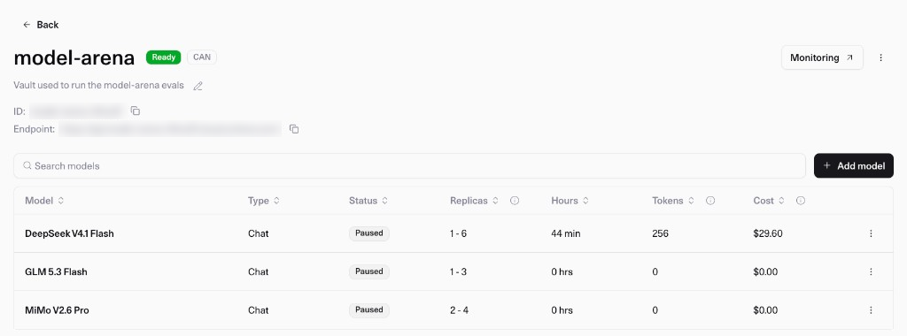
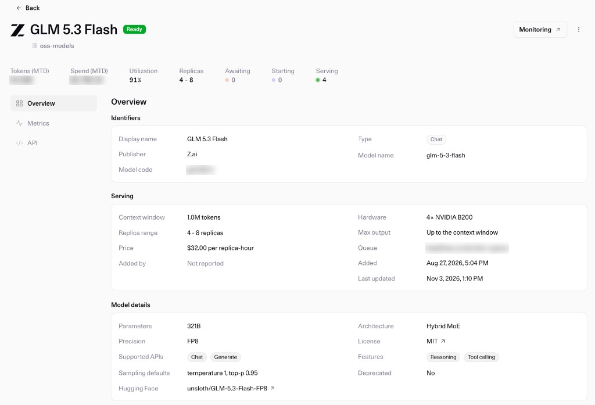

## Vault page

Clicking into any of the Vaults opens its page:

You can see the Vault's status, region, and description, its ID, and its **Endpoint**, which you'll
need to call this Vault over the API. The table lists each model with its type, status, replica range,
hours, tokens, and cost. From this page, you can:

- Search the Vault's models, or click `Add model` to add one.
- Click `Monitoring` to open the Vault's [monitoring dashboard](../../docs/model-vault/monitoring).
- Use the menu in the top-right corner to pause, resume, duplicate, or delete the Vault.
- Use the menu at the end of a model's row to edit, duplicate, pause, resume, or delete that model.

<Warning>
Pausing a model or a Vault shuts down its replicas and halts all ongoing traffic.
</Warning>

## Model page

Clicking a model opens its page:

The header shows the model's tokens and spend for the month to date, its utilization, its replica
range, and how many replicas are awaiting, starting, and serving. The page has three sections:

- **Overview**: the model's identifiers, including the **Model name** to send in API requests and the
  model code to quote to support; how it's served, including its hardware, context window, replica
  range, and price per replica-hour; and model details such as parameters, precision, supported APIs,
  license, and features.
- **Metrics**: the model's live serving metrics.
- **API**: the endpoint and a request you can run against this model.

Use the menu in the top-right corner to edit or delete the model. Editing lets you change its minimum
and maximum replicas.

<Note>
For encrypted vaults, editing or resuming re-attests the deployment, and clients re-verify
[remote attestation](../../docs/model-vault/encrypted/attestation) on the next connection.
</Note>

## Next steps

- [Calling a Vault over the API](../../docs/model-vault/standard/api-access)
- [Monitoring](../../docs/model-vault/monitoring)
