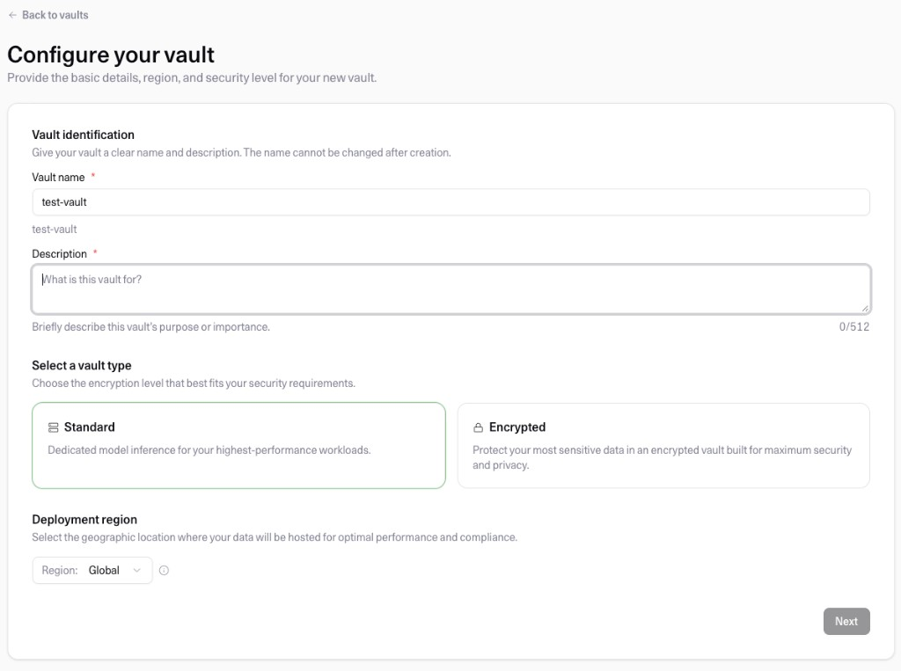
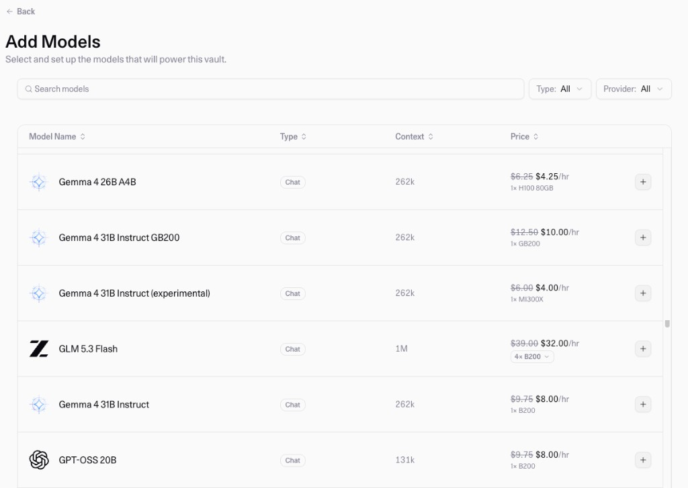
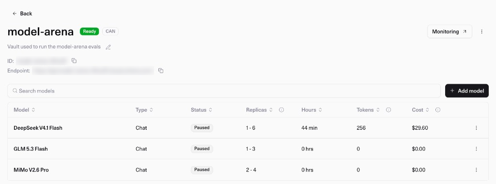
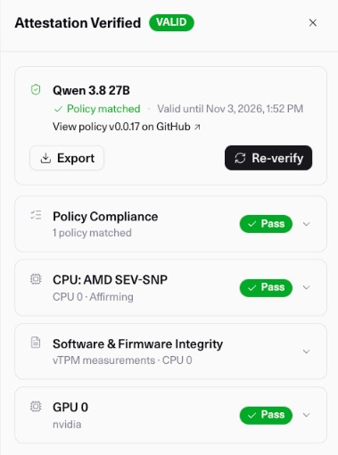

This quickstart walks you through creating your first vault from the Model Vault app and making an
inference request against it. The same flow applies to every vault; the only choice is whether to
create a **Standard** or an **Encrypted** vault.

<Steps>
## Configure your vault

Sign in to the [Model Vault app](https://vault.cohere.com/), open **Model vaults**, and create a new
vault.
Enter a name and a description, select the vault type, **Standard** or **Encrypted**, and choose the
[region](../../docs/model-vault/regions). None of these can be changed after creation. Encrypted vaults
run inside hardware-backed trusted execution environments and support remote attestation. See
[Encrypted Vaults](../../docs/model-vault/encrypted).



## Add models

Click **Next**. In the model catalogue, add a Cohere model or an open model, choose its GPU, and set
the replica range, then click **Deploy**. See
[Creating a Vault](../../docs/model-vault/creating-a-vault) for the full walkthrough.



## Get your endpoint and model name

Once the vault status is **Ready**, copy the **Endpoint** from the vault page. Then open a model and
copy its **Model name**, the value to send in API requests. See
[Calling a Vault over the API](../../docs/model-vault/standard/api-access).



## (Encrypted only) Verify the attestation

If you created an encrypted vault, the client verifies the deployment's remote attestation
automatically before sending any data, and refuses the connection if it does not pass. You can also inspect the
attestation results, the CPU, GPU, software, and policy checks, in the Model Vault app or through the API,
so you have proof of exactly what is running. See
[Verifying Your Deployment](../../docs/model-vault/encrypted/verifying-deployment) and
[Remote Attestation](../../docs/model-vault/encrypted/attestation).



## Make a request

Point the Cohere SDK at your vault endpoint and call it like any other Cohere model.

```python PYTHON
import cohere

co = cohere.ClientV2(
    api_key="<COHERE_API_KEY>",
    base_url="<YOUR_VAULT_ENDPOINT_URL>",
)

response = co.chat(
    model="<YOUR_VAULT_MODEL_NAME>",
    messages=[{"role": "user", "content": "Hello from Model Vault!"}],
)

print(response.message.content[0].text)
```

For an open model such as `deepseek-v4-1-flash`, use an OpenAI-compatible client with the base URL
`<YOUR_VAULT_ENDPOINT_URL>/v1` instead. See
[Calling open models](../../docs/model-vault/standard/api-access#calling-open-models).

</Steps>

## Next steps

- [Managing Vaults](../../docs/model-vault/managing-vaults): view vault details, edit, pause/resume, and delete models.
- [Calling a Vault over the API](../../docs/model-vault/standard/api-access): full request patterns, base URL configuration, and supported endpoints.
- [Monitoring](../../docs/model-vault/monitoring): track latency, throughput, and utilization.
- Go deeper on your vault type: [Standard Vault](../../docs/model-vault/standard) or [Encrypted Vault](../../docs/model-vault/encrypted).
