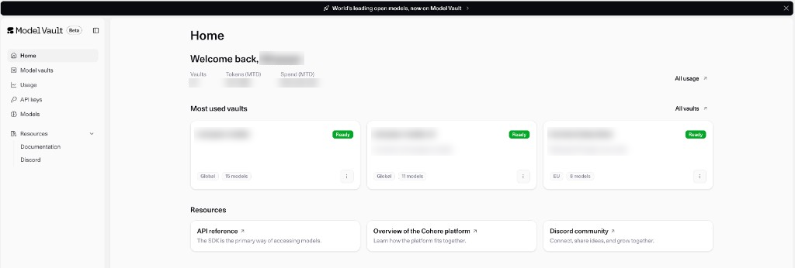

All of your vaults live in one place. Sign in to the
[Model Vault app](https://vault.cohere.com/) to open **Home**.

Home shows:

- Your organization's vault count, tokens, and spend for the month to date. Select **All usage** for
  details.
- Your most used vaults, with each vault's status, region, and number of models. Select **All vaults**
  to see every vault, Standard and Encrypted.
- Links to the API reference, platform overview, and Discord community.

The left-hand menu also opens **Model vaults**, where you view, manage, and create vaults, as well as
**Usage**, **API keys**, and **Models**.

Each Vault will have a status tag with one of the following values:

- Pending
- Deploying
- Ready
- Degraded

<Note>
Encrypted vaults also carry a verification badge that reflects their
[remote attestation](../../docs/model-vault/encrypted/attestation) status. See
[Encrypted Vaults](../../docs/model-vault/encrypted).
</Note>

## Next steps

- [Creating a Vault](../../docs/model-vault/creating-a-vault)
- [Managing Vaults](../../docs/model-vault/managing-vaults)
